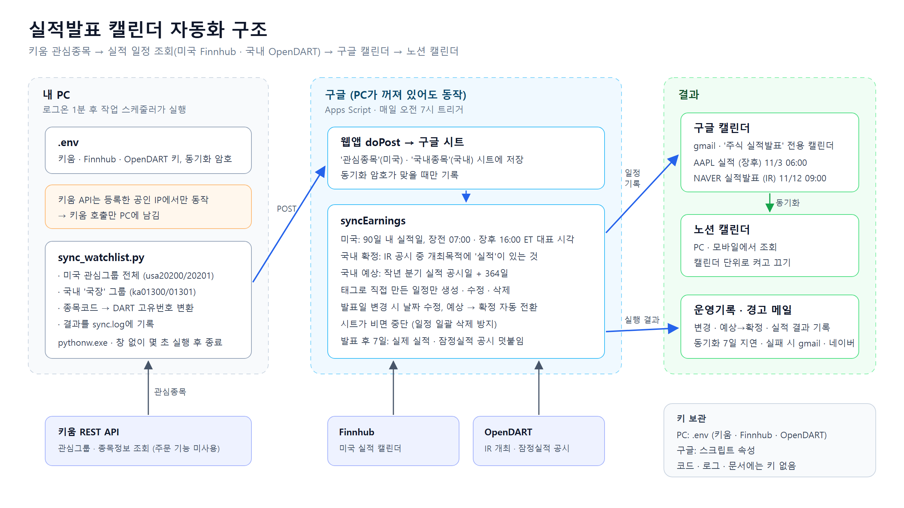

# 실적발표 캘린더 자동화

[](https://github.com/msh1661/earnings-calendar-automation/actions/workflows/test.yml)

키움증권 관심종목의 실적발표 일정을 매일 자동으로 조회해 구글 캘린더(노션 캘린더)에 기록한다.



## 동작 방식

- **PC (로그온 시):** `sync_watchlist.py`가 키움 REST API로 미국 관심그룹 전체와 국내 지정 그룹을 읽어 구글 시트로 보낸다. 키움 API는 등록한 IP에서만 호출되므로 이 단계만 PC에 둔다.
- **구글 (매일 오전 7시):** Apps Script `syncEarnings`가 시트의 종목으로 실적 일정을 조회해 캘린더에 반영하고, 결과를 '운영기록' 시트에 남긴다. PC가 꺼져 있어도 동작한다.
  - 미국: Finnhub 실적 캘린더 (장전 07:00 · 장후 16:00 ET 대표 시각)
  - 국내 확정: OpenDART '기업설명회(IR) 개최' 공시 중 개최목적에 '실적'이 있는 것
  - 국내 예상: 작년 같은 시기 분기 실적 공시일 + 364일
  - 발표 후 7일 동안: 미국은 실제 EPS·매출과 예상 대비 차이(상회·부합·하회), 국내는 잠정실적 공시 링크를 덧붙인다.
  - PC 동기화가 7일 이상 멈추거나, 실행이 실패하거나, 미국 종목 절반 이상 조회에 실패하면 경고 메일을 보낸다(같은 경고는 3일에 한 번).

## 파일

| 파일 | 역할 |
|---|---|
| `sources.py` | 키움 · OpenDART · Finnhub 조회 함수 |
| `sync_watchlist.py` | 관심종목을 Apps Script 웹앱으로 전송 |
| `check_connection.py` | 키움 · Finnhub 연결 점검 |
| `preview_earnings.py` | 미국 실적 일정 미리보기 |
| `apps_script/Code.gs` | 웹앱, 매일 실적 동기화, 실적 결과 반영, 경고 메일, 운영기록 |
| `tests/` | Code.gs(Node)와 sources.py(Python) 테스트, 공개 공시 샘플 |
| `.env.example` | 설정 템플릿 |

## 설정 요약

1. `.env.example`을 `.env`로 복사하고 키를 채운다.
2. 구글 시트 > 확장 프로그램 > Apps Script에 `Code.gs`를 붙여넣고, 시간대를 서울로 설정한다.
3. 스크립트 속성에 `FINNHUB_API_KEY`, `SYNC_TOKEN`, `CALENDAR_ID`, `OPENDART_API_KEY`, `ALERT_EMAILS`(선택, 쉼표 구분)를 넣는다.
4. 웹앱으로 배포하고 URL을 `.env`의 `APPS_SCRIPT_URL`에 넣는다.
5. `python sync_watchlist.py` 실행 → Apps Script에서 `syncEarnings`, `setupDailyTrigger` 실행.
6. Windows 작업 스케줄러에 로그온 시 `pythonw.exe sync_watchlist.py` 실행을 등록한다.

표준 라이브러리만 사용한다(Python 3.11).

## 테스트

외부 API와 구글 서비스는 가짜 객체로 대신하므로 키 없이 실행된다. GitHub에 올릴 때마다 Actions에서 자동으로 실행된다.

```bash
node --test "tests/*.test.js"
python -m unittest discover -s tests -v
```

| 대상 | 확인하는 실패 조건 |
|---|---|
| 미국 일정 변환 | 서머타임 전후 한국 시각, 시간 미정 → 종일 일정, ADR 티커 유지, 실제 EPS 상회·부합·하회 |
| 국내 공시 해석 | 실적 IR만 채택, 컨퍼런스 IR·월별 판매 공시 제외, 정정 IR은 최신 것, 확정 IR과 가까운 예상 일정 생략 |
| 캘린더 반영 | 날짜 변경 이동, 예상→확정 전환, 빠진 종목 정리, 태그 없는 개인 일정 보호, 시트가 비면 삭제 없이 중단 |
| 경고 메일 | 7일 이상 동기화 없음, 3일 안 중복 발송 방지, 미국 조회 절반 이상 실패, 실행 실패 |
| 웹앱 | 잘못된 동기화 암호 거부, 종목코드 앞자리 0 유지 |
| PC 스크립트 | `.env` 해석, 국내 그룹 이름 오류 안내, DART 고유번호 캐시, ADR 티커, 서머타임 |

테스트가 실제로 버그를 잡는지 확인하려면 `GAS_CODE_PATH`에 일부러 고장 낸 `Code.gs` 경로를 주고 실행한다.

자세한 과정과 판단 근거는 [과정 정리 문서](실적발표%20캘린더%20자동화_과정정리_2026-10-29.md)에 있다.
